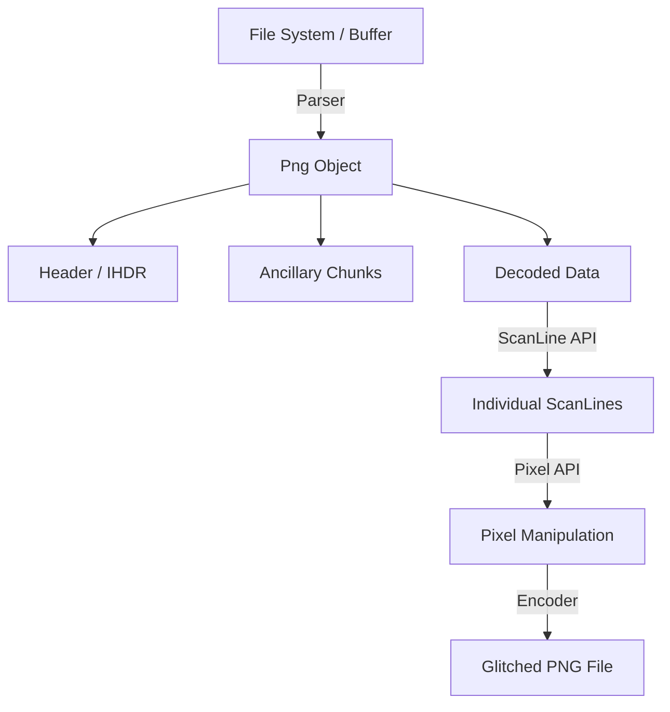

# Developer & Architecture Guide

Welcome to the `png-glitch` developer guide. This document provides an overview of the internal architecture, core concepts, and design decisions that drive the library and CLI.

## High-Level Architecture

`png-glitch` is designed to provide low-level access to the internal structures of the PNG format while offering a high-level, fluent API for creative image corruption.

Significant design decisions are recorded as [Architecture Decision Records](docs/adr/README.md) in `docs/adr/`.



### 1. The Parser (`src/png/parser.rs`)
The parser is responsible for reading the PNG signature and iterating through chunks. 
- It concatenates all `IDAT` chunks and decompresses them using the `fdeflate` crate into a single `DecodedData` buffer.
- It preserves the original order of ancillary chunks (like `PLTE` or `gAMA`) to ensure the glitched output remains a valid (though "broken") PNG.

### 2. The `Png` & `PngGlitch` Container
- **`Png`**: The internal representation of the image. It holds the `MetaData` (from `IHDR`), a list of `Chunk` objects, and the raw `DecodedData`.
- **`PngGlitch`**: The public-facing wrapper that provides the fluent API. It owns a `Png` instance and manages high-level operations like `apply(preset)` or `save()`.

### 3. ScanLines & Filters (`src/png/scan_line.rs`)
The core of the glitching logic happens at the `ScanLine` level. A PNG image is a series of scanlines, each starting with a **Filter Type** byte.
- **Filter Mismatching:** This is the primary glitch technique. By changing the filter type byte without transforming the data (or vice versa), we force the PNG decoder to misinterpret the pixel values.
- **Sequential Processing:** Many filters (like `Up` or `Paeth`) depend on the previous scanline. The library handles these dependencies correctly when "removing" or "applying" filters.

### 4. The Pixel API
To support different bit depths (1, 2, 4, 8, 16) and color types (RGB, Grayscale, etc.) without exposing the user to raw bit-shifting, we use the `Pixel` enum.
- **`process_pixels`**: This is a high-performance API that resolves the image format *once* per scanline and provides a branch-free loop for manipulation.

## Design principles

> **png-glitch produces PNGs whose format is valid but whose data is strange, and enjoys the generative changes that a standard PNG decoder produces from that data.**

These principles are the criteria for API design and performance work, and reviewers check new features against them. They were adopted in [ADR 0002](docs/adr/0002-design-principles.md) (from #94). They describe the PNG path (`png-glitch`, the PNG side of `glitch-context`, and the CLI); `webp-glitch` is not covered.

### Where the look comes from

A PNG has three layers, and png-glitch treats each one differently:

| Layer | What it contains | What png-glitch does with it |
| :---- | :--------------- | :--------------------------- |
| Compressed layer | IDAT chunks (zlib stream), CRCs, Adler-32 | Regenerated cleanly on every save. Never glitched. |
| Scan-line layer | Per row: the filter-type byte and the filtered bytes | **The only layer effects mutate.** |
| Reconstruction | Pixels, rebuilt by the decoder from the scan-line layer | Left to a conforming decoder, which propagates prediction errors right (Sub), down (Up) and diagonally (Average, Paeth). |

Compression is lossless, so `inflate(deflate(x)) == x`: skipping it changes no pixel. Reconstruction (unfiltering) is where the result is made, and it must stay exact.

### Consequences

1. **The core model is always a PNG:** IHDR plus the filtered scan-line stream. Effects only ever operate on that model.
2. **Two kinds of ends around the same core:**
   - *file*: parse and inflate ↔ deflate and serialize.
   - *live*: pixels → PNG filter step `E` (encode side) ↔ PNG unfilter step `D` → pixels (decode side).
3. **Live rendering must be identical to a PNG decoder** (#96). Otherwise it degrades into a "PNG-like effect".
4. **Every live frame is a real PNG.** Live mode is "a PNG whose compression is deferred": a frame is `D(G(E(frame)))`, where `G` is the glitch on scan lines (#100). Compression and all checksums happen only when a file is produced (save or snapshot), never per frame. A snapshot writes exactly the frame that was on screen as a valid PNG file.
5. **PNG encoding choices are expressive parameters,** not plumbing (#95). Filter strategy, color type (palette, gray, RGB/RGBA) and bit depth change the byte layout and therefore the character of the glitch, in live mode too.
6. **Performance trade-offs reduce resolution or frame rate, not expressive range.** Paeth's diagonal propagation is core to the look and must not be dropped for speed.
7. **Out of scope: corrupting the compressed stream itself.** It mostly yields invalid zlib data, which breaks "valid format". If it is ever added, it is a separate, clearly labelled mode with its own ADR.

### Setting a filter type vs. computing filtered values

These are different operations, and the difference matters:

- **Filtered values are computed once, by `E`** (pixels → scan lines), from the initial filter type chosen for each row (fixed, per-row pattern, adaptive, …). For file input, the initial types are the ones chosen by the encoder that produced the file.
- **A glitch (`G`) only overwrites bytes:** the filter-type tag and/or the filtered bytes. A mismatch between a row's tag and its values is the source of the glitch, so `G` must never recompute values to "fix" it.
- **Saving never recomputes values:** it compresses what is there and adds checksums.
- **Recomputing after glitches is a new generation.** Removing and re-applying filters after `G` means `D` then `E`: the glitches so far are baked into pixels and a new filter pass starts (a "glitch of a glitch"). That is a legitimate, expressive operation, but it is an **explicit generation boundary**, not an ordinary glitch step. The rule "one `E` and one `D` per generation" holds.

Current operations:

| Operation | What it does | Recomputes filtered values? |
| :-------- | :----------- | :-------------------------- |
| `PngGlitch::set_filter_type`, `ScanLine::set_filter_type` | Overwrites the per-row filter-type byte (the tag) | No |
| `ChangeFilterType` (glitch-context effect) | Overwrites the tag of random rows | No |
| `PngGlitch::encode`, `save` | Compresses the current scan lines as they are, adds CRCs | No |
| `PngGlitch::remove_filter`, `remove_filter_from` | Reconstructs rows (`D`) | **Yes** |
| `PngGlitch::apply_filter`, `apply_filter_from` | Filters rows (`E`) | **Yes** |
| `PngGlitch::reencode_with`, `change_filter_type` (alias) | Removes the filter, then applies another one | **Yes** (full `D` then `E`) |
| glitch-context `RemoveFilter`, `SubFilter`, `UpFilter`, `AverageFilter`, `PaethFilter`; CLI `--remove-filter`, `--sub`, `--up`, `--average`, `--paeth`, `--pre-process` | Call `change_filter_type` internally | **Yes** |

### Review checklist

When reviewing a new effect or API change, check:

- [ ] Does it change anything other than the scan-line layer (filter-type bytes and filtered bytes)? If so, why?
- [ ] Is every output a valid PNG, without relying on the encoder to repair it?
- [ ] Does it recompute filtered values? If so, is that an explicit generation boundary, named and documented as such?
- [ ] Does a performance change reduce expressive range (for example, skip Paeth or force one color type)? Prefer reducing resolution or frame rate.
- [ ] Are PNG encoding choices exposed as parameters rather than fixed internally?
- [ ] Is an effect in `png-glitch` deterministic, with any "random" choice (rows, pixels, offsets) taken as an explicit parameter? `png-glitch` has no RNG ([ADR 0003](docs/adr/0003-home-of-high-level-effects.md)). Callers that draw those choices from an RNG must take it explicitly, so that a seed reproduces the result.

## Core Concepts for Contributors

### Terminology Glossary

Because `png-glitch` operates at both the PNG container level and the artistic effect level, several terms have specific meanings across crates:

| Term | Crate | Meaning |
| :--- | :--- | :--- |
| **PNG Filter** (`FilterType`) | `png-glitch` | One of the 5 PNG scanline prediction algorithms (`None`, `Sub`, `Up`, `Average`, `Paeth`) from the PNG spec. Manipulated via `PngGlitch::reencode_with`, `set_filter_type`, `apply_filter`, and `remove_filter`. |
| **Preset** (`GlitchPreset`) | `png-glitch::presets` | A deterministic, stateless per-scanline pixel transformation (`Invert`, `Brighten`, `Darken`, `ShiftChannels`) applied via `PngGlitch::apply`. |
| **Glitch Filter / Effect** (`GlitchFilter` / `Effect`) | `glitch-context` | A high-level glitch effect (possibly randomized with an RNG) queued into a `GlitchContext` via `add_filter`. |
| **`png_glitch::Transpose`** | `png-glitch` | A deterministic operation trait (`PngGlitch::transpose(src, dst, lines)`) that swaps two contiguous blocks of scanlines. |
| **`glitch_context::Transpose`** (`RandomTranspose`) | `glitch-context` | A randomized effect that iterates through scanlines and swaps rows with probability `magnitude`. Also exported as `RandomTranspose` to avoid ambiguity with `png_glitch::Transpose`. |

### The "Glitch" Philosophy
Unlike a standard image library that aims for fidelity, `png-glitch` treats the PNG specification as a playground. The playground has one firm boundary: the output is always a valid PNG. The data inside is strange, and the visual artifacts come from what a conforming decoder makes of it. See [Design principles](#design-principles).

### Performance & Parallelism
We use the `rayon` crate for high-performance processing:
- **Batch Processing:** The CLI parallelizes processing of multiple images across all available CPU cores.
- **Scanline Processing:** Most glitch presets (like `Invert` or `Brighten`) are parallelized at the scanline level using `par_foreach_scanline`.
- **Optimization:** Filters like `BlockScramble` are optimized to minimize memory allocation and redundant scanline pre-fetching.

### High-Level Orchestration
The `glitch-context` crate provides a unified API for managing complex glitch pipelines.
- **`GlitchFilter` Trait:** All effects are implemented as modular filters.
- **`FilterConfig`:** A unified configuration enum that supports YAML serialization and deserialization.
- **`add_from_config`:** A single method to apply complex effect stacks from external configuration files.

## Deep Dive Specifications

For detailed information on specific subsystems, refer to the following documents in `crates/png-glitch/specs/`:

- [**Filter System**](crates/png-glitch/specs/FILTER_SYSTEM.md): How the 5 PNG filters work and how to abuse them.
- [**Pixel Formats**](crates/png-glitch/specs/PIXEL_FORMATS.md): Details on bit depth packing and color type handling.
- [**Parsing & Encoding**](crates/png-glitch/specs/PARSING_ENCODING.md): The lifecycle of a PNG file within the library.
- [**Glitch Operations**](crates/png-glitch/specs/GLITCH_OPERATIONS.md): Technical details on transposition and presets.

## Fuzzing & Security
Because we parse raw bytes from potentially untrusted files, we maintain `cargo-fuzz` targets in the top-level `fuzz/` directory. It is a standalone crate (it has its own `[workspace]` table and `Cargo.lock`), so run the commands below from inside `fuzz/`.

| Target | What it exercises |
| --- | --- |
| `png_parse` | `PngGlitch::from_bytes_with_options` in lenient and strict mode, then re-encode. |
| `png_glitch_ops` | Parse, then `remove_filter`/`apply_filter`, presets, `transpose`, and encode. |
| `glitch_context_pipeline` | `AnyGlitchContext` (PNG or WebP): parse, queue every `FilterConfig` variant, execute, encode. |
| `webp_riff` | `RiffContainer::parse`, encode/re-parse round trip, and every chunk mutation. |

```bash
rustup toolchain install nightly
cargo install cargo-fuzz --locked
cd fuzz
./scripts/seed-corpus.sh --download-pngsuite   # seeds corpus/<target>/ from etc/ samples and PngSuite
cargo +nightly fuzz run png_parse -- -max_total_time=300
```

A `cargo-fuzz` installed from a prebuilt musl binary (as `taiki-e/install-action` does in CI) defaults to `--target x86_64-unknown-linux-musl`, where AddressSanitizer does not work; pass `--target x86_64-unknown-linux-gnu` to every `cargo +nightly fuzz` command (CI does).

Crashing inputs are written to `fuzz/artifacts/<target>/`; reproduce one with `cargo +nightly fuzz run <target> <file>`. CI builds every target on each pull request, and `.github/workflows/fuzz.yml` fuzzes each target on a schedule (or on demand via *Run workflow*) and uploads any crashes as workflow artifacts. Contributors modifying a parser or filter should run the relevant target locally. When `FilterConfig` gains a variant, `fuzz_targets/glitch_context_pipeline.rs` stops compiling until the new variant is added to its filter list.
