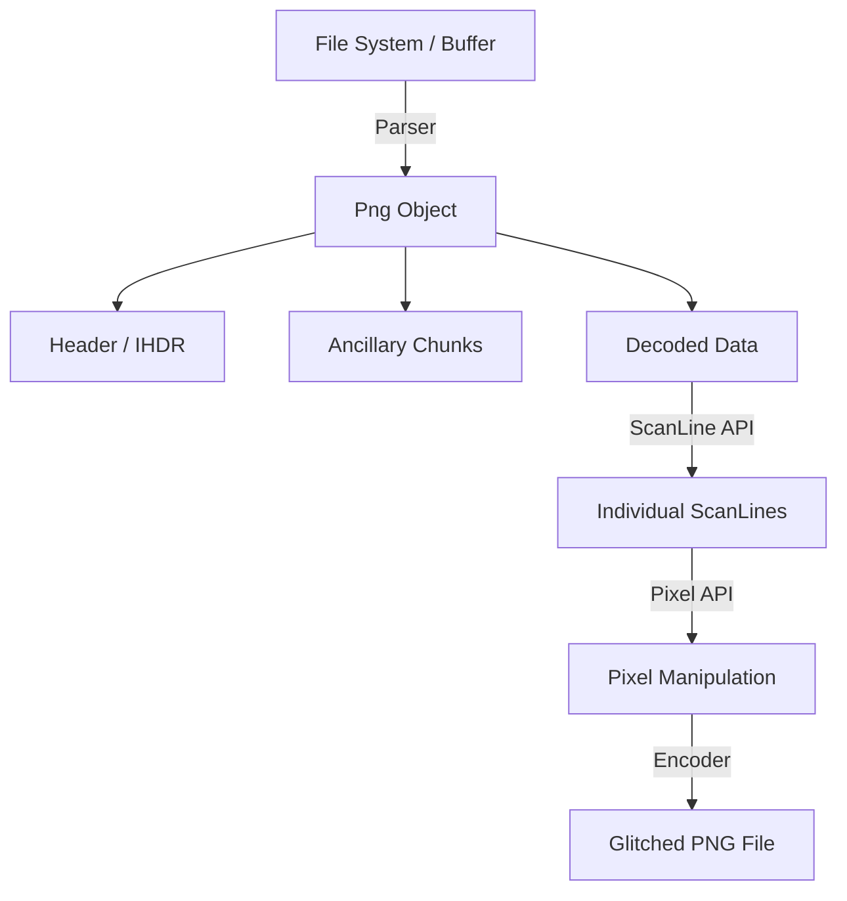

# Developer & Architecture Guide

Welcome to the `png-glitch` developer guide. This document provides an overview of the internal architecture, core concepts, and design decisions that drive the library and CLI.

## High-Level Architecture

`png-glitch` is designed to provide low-level access to the internal structures of the PNG format while offering a high-level, fluent API for creative image corruption.



### 1. The Parser (`src/png/parser.rs`)
The parser is responsible for reading the PNG signature and iterating through chunks. 
- It concatenates all `IDAT` chunks and decompresses them using the `fdeflate` crate into a single `DecodedData` buffer.
- It preserves the original order of ancillary chunks (like `PLTE` or `gAMA`) to ensure the glitched output remains a valid (though "broken") PNG.

### 2. The `Png` & `PngGlitch` Container
- **`Png`**: The internal representation of the image. It holds the `MetaData` (from `IHDR`), a list of `Chunk` objects, and the raw `DecodedData`.
- **`PngGlitch`**: The public-facing wrapper that provides the fluent API. It owns a `Png` instance and manages high-level operations like `apply(preset)` or `save()`.

### 3. ScanLines & Filters (`src/png/scan_line.rs`)
The core of the glitching logic happens at the `ScanLine` level. A PNG image is a series of scanlines, each starting with a **Filter Type** byte.
- **Filter Mismatching:** This is the primary glitch technique. By changing the filter type byte without transforming the data (or vice versa), we force the PNG decoder to misinterpret the pixel values.
- **Sequential Processing:** Many filters (like `Up` or `Paeth`) depend on the previous scanline. The library handles these dependencies correctly when "removing" or "applying" filters.

### 4. The Pixel API
To support different bit depths (1, 2, 4, 8, 16) and color types (RGB, Grayscale, etc.) without exposing the user to raw bit-shifting, we use the `Pixel` enum.
- **`process_pixels`**: This is a high-performance API that resolves the image format *once* per scanline and provides a branch-free loop for manipulation.

## Core Concepts for Contributors

### Terminology Glossary

Because `png-glitch` operates at both the PNG container level and the artistic effect level, several terms have specific meanings across crates:

| Term | Crate | Meaning |
| :--- | :--- | :--- |
| **PNG Filter** (`FilterType`) | `png-glitch` | One of the 5 PNG scanline prediction algorithms (`None`, `Sub`, `Up`, `Average`, `Paeth`) from the PNG spec. Manipulated via `PngGlitch::reencode_with`, `set_filter_type`, `apply_filter`, and `remove_filter`. |
| **Preset** (`GlitchPreset`) | `png-glitch::presets` | A deterministic, stateless per-scanline pixel transformation (`Invert`, `Brighten`, `Darken`, `ShiftChannels`) applied via `PngGlitch::apply`. |
| **Glitch Filter / Effect** (`GlitchFilter` / `Effect`) | `glitch-context` | A high-level glitch effect (possibly randomized with an RNG) queued into a `GlitchContext` via `add_filter`. |
| **`png_glitch::Transpose`** | `png-glitch` | A deterministic operation trait (`PngGlitch::transpose(src, dst, lines)`) that swaps two contiguous blocks of scanlines. |
| **`glitch_context::Transpose`** (`RandomTranspose`) | `glitch-context` | A randomized effect that iterates through scanlines and swaps rows with probability `magnitude`. Also exported as `RandomTranspose` to avoid ambiguity with `png_glitch::Transpose`. |

### The "Glitch" Philosophy
Unlike a standard image library that aims for fidelity, `png-glitch` treats the PNG specification as a playground. We often perform operations that are "illegal" or "undefined" in standard decoders to see what visual artifacts they produce.

### Performance & Parallelism
We use the `rayon` crate for high-performance processing:
- **Batch Processing:** The CLI parallelizes processing of multiple images across all available CPU cores.
- **Scanline Processing:** Most glitch presets (like `Invert` or `Brighten`) are parallelized at the scanline level using `par_foreach_scanline`.
- **Optimization:** Filters like `BlockScramble` are optimized to minimize memory allocation and redundant scanline pre-fetching.

### High-Level Orchestration
The `glitch-context` crate provides a unified API for managing complex glitch pipelines.
- **`GlitchFilter` Trait:** All effects are implemented as modular filters.
- **`FilterConfig`:** A unified configuration enum that supports YAML serialization and deserialization.
- **`add_from_config`:** A single method to apply complex effect stacks from external configuration files.

## Deep Dive Specifications

For detailed information on specific subsystems, refer to the following documents in `crates/png-glitch/specs/`:

- [**Filter System**](crates/png-glitch/specs/FILTER_SYSTEM.md): How the 5 PNG filters work and how to abuse them.
- [**Pixel Formats**](crates/png-glitch/specs/PIXEL_FORMATS.md): Details on bit depth packing and color type handling.
- [**Parsing & Encoding**](crates/png-glitch/specs/PARSING_ENCODING.md): The lifecycle of a PNG file within the library.
- [**Glitch Operations**](crates/png-glitch/specs/GLITCH_OPERATIONS.md): Technical details on transposition and presets.

## Fuzzing & Security
Because we parse raw bytes from potentially untrusted files, we maintain `cargo-fuzz` targets in the top-level `fuzz/` directory. It is a standalone crate (it has its own `[workspace]` table and `Cargo.lock`), so run the commands below from inside `fuzz/`.

| Target | What it exercises |
| --- | --- |
| `png_parse` | `PngGlitch::from_bytes_with_options` in lenient and strict mode, then re-encode. |
| `png_glitch_ops` | Parse, then `remove_filter`/`apply_filter`, presets, `transpose`, and encode. |
| `glitch_context_pipeline` | `AnyGlitchContext` (PNG or WebP): parse, queue every `FilterConfig` variant, execute, encode. |
| `webp_riff` | `RiffContainer::parse`, encode/re-parse round trip, and every chunk mutation. |

```bash
rustup toolchain install nightly
cargo install cargo-fuzz --locked
cd fuzz
./scripts/seed-corpus.sh --download-pngsuite   # seeds corpus/<target>/ from etc/ samples and PngSuite
cargo +nightly fuzz run png_parse -- -max_total_time=300
```

Crashing inputs are written to `fuzz/artifacts/<target>/`; reproduce one with `cargo +nightly fuzz run <target> <file>`. CI builds every target on each pull request, and `.github/workflows/fuzz.yml` fuzzes each target on a schedule (or on demand via *Run workflow*) and uploads any crashes as workflow artifacts. Contributors modifying a parser or filter should run the relevant target locally. When `FilterConfig` gains a variant, `fuzz_targets/glitch_context_pipeline.rs` stops compiling until the new variant is added to its filter list.
