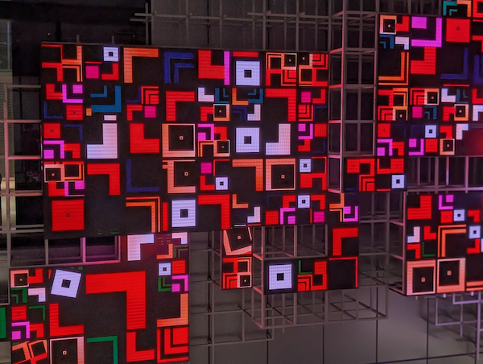
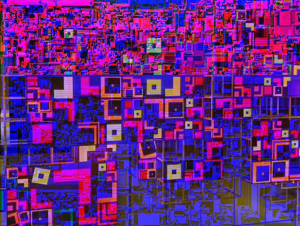

# png-glitch: a tool to glitch PNG and WebP images

`png-glitch` is a powerful tool and library suite for the intentional corruption of **PNG** and **WebP** images, creating unique "glitch art" by manipulating pixel data, scanline filters, and underlying compression structures.

## Installation

To install `png-glitch` from crates.io, run the following command:

```zsh
% cargo install png-glitch-cli --locked
```

## Usage

`png-glitch` glitches a given PNG or WebP file (or directory) and emits the result. Image format is auto-detected from file magic bytes (`PNG` or `RIFF....WEBP`). By default, it saves to `<input-stem>-glitched.<ext>` next to the input file and refuses to overwrite an existing file unless `--force` is specified.

```zsh
% png-glitch [OPTIONS] <INPUT>
% png-glitch input.png -o result.png --invert
% png-glitch input.webp -o result.webp --macroblock-glitch 0.15 --chromatic-aberration 0.2
% png-glitch input.png -f sub-filter -f replace=0.05 -f 'chromatic-aberration:magnitude=0.2,r=4,b=-4'
% png-glitch --list-filters
```

### Repeatable `-f / --filter` Flag

In addition to individual filter flags, you can compose a pipeline of any length (including applying the same filter multiple times with different parameters) using `-f` / `--filter`:

- `<filter>` (e.g. `-f invert`, `-f sub-filter`)
- `<filter>=<value>` (e.g. `-f replace=0.05`, `-f brighten=1200`, `-f shift-channels=12,0,-12`)
- `<filter>:key1=val1,key2=val2` (e.g. `-f 'chromatic-aberration:magnitude=0.2,r=4,b=-4'`, `-f 'block-scramble:magnitude=0.1,size=64'`)

Run `png-glitch --list-filters` to inspect all supported filter specs, parameters, defaults, and format support.

### Supported Formats & Filter Compatibility

Multiple filters can be combined and are applied in the exact order they appear on the command line or in a YAML config.

| CLI Option / `-f` Name | YAML `type` (kebab-case / PascalCase) | Formats | Parameters & Defaults | Description |
| :--- | :--- | :---: | :--- | :--- |
| `--invert` | `invert` / `Invert` | PNG, WebP | — | Inverts all color values. |
| `--brighten <STRENGTH>` | `brighten` / `Brighten` | PNG, WebP | `strength` (`0..=65535`) | Saturating brightness increase capped at bit-depth maximum. |
| `--darken <STRENGTH>` | `darken` / `Darken` | PNG, WebP | `strength` (`0..=65535`) | Saturating brightness decrease floored at 0. |
| `--shift-channels <R,G,B>` | `shift-channels` / `ShiftChannels` | PNG, WebP | `r`, `g`, `b` (`i16`) | Shifts R, G, B channel values independently (wrapping). |
| `--chromatic-aberration <MAG>` | `chromatic-aberration` / `ChromaticAberration` | PNG, WebP | `magnitude` (`0.0..=1.0`), `r_offset=2`, `g_offset=0`, `b_offset=-2` | Displaces R/G/B channels horizontally for a color fringe effect. |
| `--pixel-sort <MAG>` | `pixel-sort` / `PixelSort` | PNG, WebP | `magnitude` (`0.0..=1.0`), `criterion=brightness` (`brightness` \| `hue`) | Sorts pixels within scanlines/rows by brightness or hue. |
| `--bitwise <MAG>` | `bitwise` / `Bitwise` | PNG, WebP | `magnitude` (`0.0..=1.0`), `op=xor` (`and` \| `or` \| `xor`), `value=128` | Applies a bitwise operation to pixel data. |
| `--channel-swap <MAG>` | `channel-swap` / `ChannelSwap` | PNG, WebP | `magnitude` (`0.0..=1.0`), `target=rg` (`rg` \| `gb` \| `br`) | Swaps two color channels. |
| `--horizontal-shift <MAG>` | `horizontal-shift` / `HorizontalShift` | PNG, WebP | `magnitude` (`0.0..=1.0`) | Circularly shifts scanlines/rows horizontally. |
| `--color-distortion <MAG>` | `color-distortion` / `ColorDistortion` | PNG, WebP | `magnitude` (`0.0..=1.0`), `strength=32` (`0..=255`) | Adds signed random deltas to RGB channels per scanline/row. |
| `--color-space-glitch <MAG>` | `color-space-glitch` / `ColorSpaceGlitch` | PNG only | `magnitude` (`0.0..=1.0`), `hue_shift=0.0`, `saturation_mult=1.0`, `lightness_mult=1.0` | Artistic HSL (Hue, Saturation, Lightness) distortion. |
| `--block-scramble <MAG>` | `block-scramble` / `BlockScramble` | PNG only | `magnitude` (`0.0..=1.0`), `block_size=32` | Shuffles rectangular blocks across scanlines. |
| `--transpose <MAG>` | `transpose` / `Transpose` | PNG only | `magnitude` (`0.0..=1.0`) | Randomly swaps blocks of scanlines. |
| `--replace <MAG>` | `replace` / `Replace` | PNG only | `magnitude` (`0.0..=1.0`) | Replaces scanline bytes with random noise. |
| `--set-zero <MAG>` | `set-zero` / `SetZero` | PNG only | `magnitude` (`0.0..=1.0`) | Zeroes out randomly selected scanlines. |
| `--random-copy <COUNT>` | `random-copy` / `RandomCopy` | PNG only | `times` (`usize`) | Copies random scanline bytes `COUNT` times. |
| `--substitute <INDEX:VALUE>` | `substitute` / `Substitute` | PNG only | `index` (`usize`), `value` (`u8`) | Substitutes a single byte in the middle scanline. |
| `--change-filter-type <MAG>` | `change-filter-type` / `ChangeFilterType` | PNG only | `magnitude` (`0.0..=1.0`) | Randomly changes PNG filter types across scanlines. |
| `-f set-filter-type=<TYPE>` | `set-filter-type` / `SetFilterType` | PNG only | `filter` (`none` \| `sub` \| `up` \| `average` \| `paeth`) | Overwrites the filter-type tag of **every** scanline and leaves the filtered bytes as they are (tag only; no value is recomputed). |
| `-f regenerate=<STRATEGY>` | `regenerate` / `Regenerate` | PNG only | `strategy`: `{ fixed: <TYPE> }` \| `{ pattern: [<TYPE>, ..] }` \| `adaptive` (CLI: `paeth`, `sub,up,paeth`, `adaptive`) | Starts a new generation: recomputes every filtered value with the strategy. |
| `--remove-filter` | `remove-filter` / `RemoveFilter` | PNG only | — | **Deprecated**, use `regenerate`. Re-encodes all scanlines with PNG filter type `None` (recomputes the filtered values; it does not just change the filter-type tag). |
| `--sub` (`--sub-filter`) | `sub-filter` / `SubFilter` | PNG only | — | **Deprecated**, use `regenerate`. Re-encodes all scanlines with PNG filter type `Sub` (recomputes the filtered values; it does not just change the filter-type tag). |
| `--up` (`--up-filter`) | `up-filter` / `UpFilter` | PNG only | — | **Deprecated**, use `regenerate`. Re-encodes all scanlines with PNG filter type `Up` (recomputes the filtered values; it does not just change the filter-type tag). |
| `--average` (`--average-filter`) | `average-filter` / `AverageFilter` | PNG only | — | **Deprecated**, use `regenerate`. Re-encodes all scanlines with PNG filter type `Average` (recomputes the filtered values; it does not just change the filter-type tag). |
| `--paeth` (`--paeth-filter`) | `paeth-filter` / `PaethFilter` | PNG only | — | **Deprecated**, use `regenerate`. Re-encodes all scanlines with PNG filter type `Paeth` (recomputes the filtered values; it does not just change the filter-type tag). |
| `--macroblock-glitch <MAG>` | `macroblock-glitch` / `MacroblockGlitch` | WebP only | `magnitude` (`0.0..=1.0`) | Corrupts 16x16 VP8 macroblocks by swapping, duplicating, or zeroing. |
| `--alpha-glitch <STRATEGY>` | `alpha-glitch` / `AlphaGlitch` | WebP only | `magnitude=1.0`, `strategy=noise` (`noise` \| `invert` \| `shift` \| `zero`) | Corrupts the alpha channel of RGBA WebP images. |
| `--lossy-quality <QUALITY>` | `lossy-artifact` / `LossyArtifact` | WebP only | `quality` (`0.0..=100.0`) | Re-encodes through lossy VP8 at low quality to introduce block artifacts. |

### Pre-processing (PNG only, applied before glitch filters)

`--pre-process` re-encodes the PNG with a specific filter type before glitching. This changes the underlying byte patterns that glitch filters operate on, producing different visual results.

```zsh
% png-glitch input.png --pre-process sub-filter --replace 0.05
```

Accepted values: `remove-filter`, `sub-filter`, `up-filter`, `average-filter`, `paeth-filter`

### Overwrite the tag, or recompute the values

Two different operations (see the [Developer Guide](DEVELOPER_GUIDE.md)):

```zsh
# Tag only: every row is now *labelled* Paeth, the bytes are untouched. The decoder misreads them.
% png-glitch input.png -f set-filter-type=paeth

# New generation: the values are recomputed, so the image looks the same but its bytes change.
% png-glitch input.png -f regenerate=paeth
% png-glitch input.png -f regenerate=adaptive
% png-glitch input.png -f regenerate=sub,up,paeth   # row i uses pattern[i % 3]
```

```yaml
filters:
  - type: regenerate
    strategy: { fixed: paeth }   # or: adaptive, or { pattern: [sub, up, paeth] }
  - type: set-filter-type
    filter: up
```

### Output & Reproducibility

| Option | Description |
| :--- | :--- |
| `-o`, `--output <FILE>` | Output file path (default: `<input-stem>-glitched.<ext>`). |
| `--batch-output <DIR>` | Output directory for batch processing when `<INPUT>` is a directory. |
| `--variations <N>` | Write N outputs with different seeds as `<out-stem>-s<seed>.<ext>`; each seed is printed and can be re-run with `--seed`. |
| `--contact-sheet <FILE>` | With `--variations`, also write a grid of all outputs (PNG input only); `--contact-cell-width <PX>` sets the cell width (default 256). |
| `--surprise` | Apply a random recipe of 2-5 steps drawn from the seed (the same `--seed` gives the same recipe and image). The recipe is always printed to stderr; `--save-recipe` / `--embed-recipe` keep it, and `--config saved.yaml --seed S` re-runs it. Cannot be combined with `-f`/`--config`. |
| `--sweep <STEP.PARAM=FROM..TO:N>` | Write N outputs where one numeric parameter of one step takes N evenly spaced values (both ends included) and the seed stays fixed, as `<out-stem>-<param>-<value>.<ext>`. `STEP` is a 0-based index or a step type name. Example: `--sweep replace.magnitude=0.01..0.2:5`. |
| `--watch` | Requires `--config`. Re-renders whenever the config file or the input changes (polled every 250 ms); the seed stays fixed, a recipe error is printed and watching continues, and the output is written atomically. |
| `--force` | Overwrite existing output file(s) without prompting. |
| `--seed <SEED>` | Random seed (`u64`) for reproducible results (printed to stderr when omitted). |
| `-c`, `--config <FILE>` | Load filter pipeline from a YAML configuration file. |
| `--print-recipe` | Print the effective recipe (flags, `-f` and `--config` merged, in order) and the seed as YAML to stderr. |
| `--save-recipe <FILE>` | Save the effective recipe as YAML. `--config FILE --seed SEED` reproduces the output byte for byte. |
| `--embed-recipe` | Embed the recipe and seed in the output PNG (an `iTXt` chunk named `png-glitch-recipe`; PNG only). |
| `--show-recipe` | Print the recipe embedded in `INPUT` and exit. |
| `--list-filters` | List all available filters, parameters, defaults, and format support. |

#### Reproducibility guarantee

For the same input, the same filter recipe, the same seed and the same **minor** version, the output is byte-identical on every platform and with any thread count. A change to seeded output is a breaking change for this guarantee and is listed under a "Seeded output changes" heading in [CHANGELOG.md](CHANGELOG.md).

The guarantee is enforced by golden hashes (`tests/cli.rs`, `crates/png-glitch-recipe/tests/golden.rs`) and by tests that compare `RAYON_NUM_THREADS=1` with `8`. Output is **not** guaranteed to be identical across minor versions, or when the seed is omitted (a random seed is chosen and printed to stderr).

## Batch Processing

To glitch multiple PNG and WebP images at once, provide a directory as `<INPUT>` and use the `--batch-output` flag. This uses **parallel processing** while preserving subdirectory structure:

```zsh
% png-glitch ./my_images --batch-output ./glitched_results --invert --horizontal-shift 0.05
```

## Configuration File (YAML)

Define complex glitch pipelines for repeatable results. Both `kebab-case` (recommended, matching CLI flags) and `PascalCase` filter `type` names are accepted:

```yaml
filters:
  - type: remove-filter
  - type: block-scramble
    magnitude: 0.1
    block_size: 32
  - type: color-space-glitch
    magnitude: 0.2
    hue_shift: 90.0
  - type: chromatic-aberration
    magnitude: 0.1
    r_offset: 3
    b_offset: -3
  - type: invert
  - type: invert
  - type: pixel-sort
    magnitude: 0.1
    criterion: hue
  - type: horizontal-shift
    magnitude: 0.05
  - type: bitwise
    magnitude: 0.02
    op: xor
    value: 255
```

Run it with:
```zsh
% png-glitch input.png --config my_glitch.yaml
```

### Targeting rows (`rows`)

Any PNG step takes an optional `rows` key (`a..b`, `a..` or `..b`; end exclusive, 0-based) that restricts it to those rows. On the command line put it in the parameter list: `-f 'replace:magnitude=0.2,rows=300..452'`.

```yaml
filters:
  - type: replace
    magnitude: 0.2
    rows: 300..452
```

- The range is clamped to the image. An empty range, or one past the last row, does nothing.
- The step is resolved for an image as tall as the range: its random choices and row numbers (`random-copy`, `transpose`, ...) are relative to the range. A step with `rows` draws a different random stream than the same step without it; a recipe without `rows` gives the same bytes as before.
- `regenerate` cannot take `rows`. `sub-filter`, `up-filter`, ... (and `remove-filter`) re-encode only the rows in the range.
- WebP input does not support `rows`.
- **What stays unchanged:** the stored bytes (filter-type tag and filtered bytes) of the rows outside the range. The *decoded* pixels below the range can still change, because a decoder rebuilds each row from the one above it (`up`, `average`, `paeth`) unless those rows use `none` or `sub`. That is how the medium works (ADR 0002), not a bug.
- `--print-recipe`, `--save-recipe` and `--embed-recipe` include `rows`, and the saved recipe gives the same output.

See the [recipe gallery](docs/CLI_GUIDE.md#6-recipes) for ready-made recipes and the images they produce.

## Documentation

- **[CLI Usage & Visual Gallery](docs/CLI_GUIDE.md)**: A comprehensive guide with visual examples.
- **[Developer & Architecture Guide](DEVELOPER_GUIDE.md)**: Deep dive into the internal design and core concepts.
- **[Spec: Filter System](crates/png-glitch/specs/FILTER_SYSTEM.md)**: Technical details on PNG filters.
- **[Spec: Pixel Formats](crates/png-glitch/specs/PIXEL_FORMATS.md)**: How we handle different bit depths and color types.

## Example

The original image:


And the glitched one:


# In this repository
This repository consists of the following crates:

- **png-glitch-cli**: A binary crate for a command line interface (CLI) to glitch PNG and WebP files.
- **[png-glitch crate](crates/png-glitch)**: Core library to glitch PNG images: parsing and encoding, scan lines, PNG filter types, pixels, and deterministic effects. It has no RNG.
- **[webp-glitch crate](crates/webp-glitch)**: Core library to glitch WebP images.
- **[png-glitch-recipe crate](crates/png-glitch-recipe)**: Recipes and randomness on top of `png-glitch`: reusable, serializable `Recipe`s that resolve with a seed into deterministic effects, the randomized filters, and the `GlitchContext` convenience wrapper.
- **[webp-glitch-context crate](crates/webp-glitch-context)**: High-level filter pipeline for WebP images (`WebpGlitchContext`) and the WebP-only effects. Reuses the configuration types of `png-glitch-recipe`.

See [ADR 0004](docs/adr/0004-png-glitch-and-recipe-crates.md) for why the crates are split this way.

# Licence

MIT License. Please refer to [LICENCE](LICENSE) file for details.
