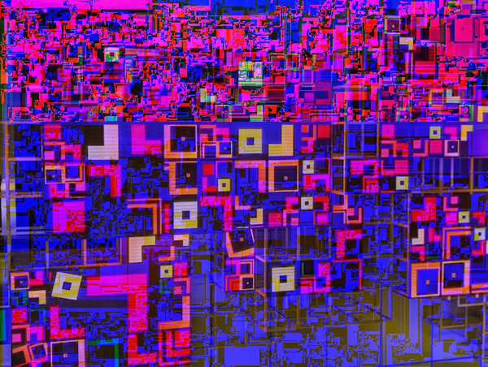
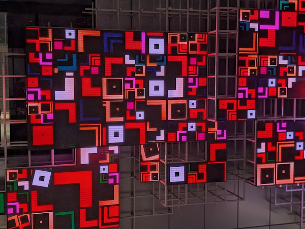
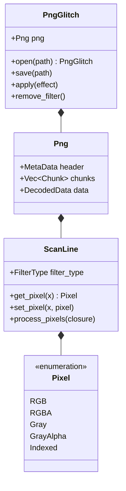

# png-glitch

A library to glitch PNG files. This library is inspired by the [pnglitch](https://github.com/ucnv/pnglitch), a Ruby library to glitch PNG images.

Please visit "[The Art of PNG Glitch](https://ucnv.github.io/pnglitch/)" for more details about glitching PNG images.



The original image: 



# Data Structures



# Example usage

The library now features a **Chainable API**, **Structured Pixel API**, and **Parallel Processing**.

The following snippet glitches `./a_png_file.png` by:
1. Removing existing PNG filters.
2. Applying an **Invert** effect.
3. Brightening the image using a **Brighten** effect.
4. Customizing a specific pixel using the safe **Pixel API**.

The glitched image is saved to `./glitched.png`.

```Rust
use png_glitch::{PngGlitch, Pixel};
use png_glitch::effects::{Invert, Brighten};

PngGlitch::open("./a_png_file.png")?
  .remove_filter()
  .apply(Invert)
  .apply(Brighten { strength: 50 })
  .par_foreach_scanline(|scan_line| {
    // High-performance parallel pixel manipulation
    if let Some(Pixel::RGB(r, g, b)) = scan_line.get_pixel(10) {
        scan_line.set_pixel(10, Pixel::RGB(r, 0, b));
    }
  })
  .save("./glitched.png")?;
```

# Available Effects

Built-in effects available in `png_glitch::effects`:

- **Invert**: Flips color values.
- **ShiftChannels**: Moves color channels (R, G, B) independently.
- **Brighten**: Increases image brightness (saturating at the bit-depth maximum).
- **Darken**: Decreases image brightness (saturating at 0).

# Key Features

- **Parallelism**: Use `par_foreach_scanline` to glitch large images fast using all CPU cores.
- **Memory Safety**: 100% safe Rust code with no `unsafe` blocks.
- **Structured Pixels**: Manipulate images at the pixel level without worrying about raw byte offsets.

# Cargo Features

- `parallel` *(enabled by default)*: Runs `par_foreach_scanline` on a [rayon](https://crates.io/crates/rayon) thread pool. Without it the method keeps the same signature and runs sequentially in row order, with byte-identical output. Disable it for a smaller WebAssembly build: `png-glitch = { version = "0.7", default-features = false }`.

# Live input: pixels instead of a PNG file

`PngGlitch::from_pixels` builds the model straight from RGBA8 pixels (webcam frames, a canvas, game output). It runs only the PNG filter step; nothing is compressed until you ask for PNG bytes. `reload_pixels` refills the model with the next frame **without allocating**.

```rust
use png_glitch::{Encoding, FilterStrategy, FilterType, PixelSource, PngGlitch};

let mut png = PngGlitch::from_pixels(
    PixelSource::rgba8(width, height, &frame),
    Encoding::rgba8(FilterStrategy::Fixed(FilterType::Paeth)),
)?;
// ... glitch it, then for the next frame:
png.reload_pixels(&next_frame)?;
let bytes = png.to_bytes()?;
```

The encoding is part of the glitch: the same frame with the same effect looks different as RGBA/Paeth, RGB with a `Sub, Up, Paeth` pattern, or gray with the adaptive heuristic (`cargo run --example encodings`). Supported: 8-bit `TrueColorAlpha`, `TrueColor` (alpha dropped), `GrayScaleAlpha` and `GrayScale` (`gray = (77R + 150G + 29B + 128) >> 8`). Filter strategies are `Fixed`, `Pattern` (row `y` uses `pattern[y % len]`) and `Adaptive` (libpng's minimum sum of absolute differences, ties to the lowest filter type; about ten times the cost of a fixed filter, so prefer `Fixed` or `Pattern` for live use). Palettes, other bit depths and `PerRow` are not supported yet.

## The per-frame loop: `LivePipeline`

`LivePipeline` owns the model, a `Renderer` and the scratch buffer, and splits a frame into `frame_out = D(G(E(frame_in)))`. `new` allocates once; `encode`, the `ScanLines` view and `decode_into` allocate nothing.

```rust
use png_glitch::{Encoding, FilterStrategy, FilterType, LivePipeline, PixelSource};

let mut live = LivePipeline::new(
    PixelSource::rgba8(width, height, &first_frame),
    Encoding::rgba8(FilterStrategy::Fixed(FilterType::Paeth)),
)?;
let mut out = vec![0u8; first_frame.len()];
loop {
    let mut lines = live.encode(&frame)?; // E: overwrites the previous glitch
    lines.swap(0, 10);                    // G: scan-line operations only
    lines.set_filter_type(5, FilterType::Sub);
    live.decode_into(&mut out)?;          // D: RGBA8, as a PNG decoder would show it
}
let png_bytes = live.snapshot()?;         // compresses; keep it off the real-time path
```

`ScanLines` is a borrowed view of the filtered rows (`PngGlitch::scan_lines_mut` gives the same view for a model opened from a file). It can read and write rows and filter-type tags, swap and copy rows, iterate sequentially or in parallel and lend a scratch buffer, but it cannot recompute filtered values, resize or compress. `LivePipeline::scan_lines` returns the view without reloading the frame. See ADR 0005.

# WebAssembly and SIMD

The PNG filter and unfilter loops are written so that LLVM can vectorise them, without `unsafe` code. On WebAssembly, build with the `simd128` target feature to get the benefit (the default build is scalar and works everywhere):

```bash
RUSTFLAGS="-C target-feature=+simd128" cargo build --release --target wasm32-unknown-unknown --no-default-features
```

With `simd128`, Paeth and Average reconstruction (`remove_filter` on images with 4-byte pixels: 8-bit RGBA, 16-bit gray + alpha) also process several rows at once: rows `y` to `y + 3` run as a wavefront, each one pixel behind the row above, so their dependency chains are independent and share SIMD vectors. This uses the safe `core::arch::wasm32` intrinsics (the crate still forbids `unsafe`) and is where `simd128` matters most. Indicative numbers for 1080p RGBA under wasmtime, one thread, p50: Paeth reconstruction is about 20 ms scalar, 13.6 ms with `simd128` and one row at a time, and 5 ms with the wavefront. Average reconstruction goes from about 4.8 ms to 2 ms. Up and Sub gain from auto-vectorisation only. The filter step (`apply_filter`, `from_pixels`) has no row-to-row dependency and is vectorised along the row instead.

Runtimes that do not support the WebAssembly SIMD proposal cannot load a `+simd128` module, so ship the scalar build as a fallback. Output is byte-identical either way.

# Contribution

See the workspace [CONTRIBUTING.md](../../CONTRIBUTING.md) guide for setup, testing, and step-by-step instructions on adding new glitch filters.

# License

Please refer to the [LICENSE](LICENSE) file.