# png-glitch CLI Visual Guide

This guide showcases every command-line option available in `png-glitch`, using `crates/png-glitch/etc/sample00.png` as the base image for comparison.

Every image was made with `--seed 42`, so you can reproduce it with the command shown plus `--seed 42`. All images are generated by [`examples/gen_gallery.rs`](../examples/gen_gallery.rs); regenerate them with:

```zsh
cargo run --release --example gen_gallery
```

> **Why do color effects look like noise on PNG?** Effects edit the *filtered* scan-line bytes, not decoded pixels (see the [Developer Guide](../DEVELOPER_GUIDE.md)). The decoder then reconstructs each pixel from its neighbours, so a small change spreads into streaks, gradients and noise; that is the glitch. Put `remove-filter` first to make the effects act on the real colors instead (see [Recipes](#6-recipes)).

## Original Image
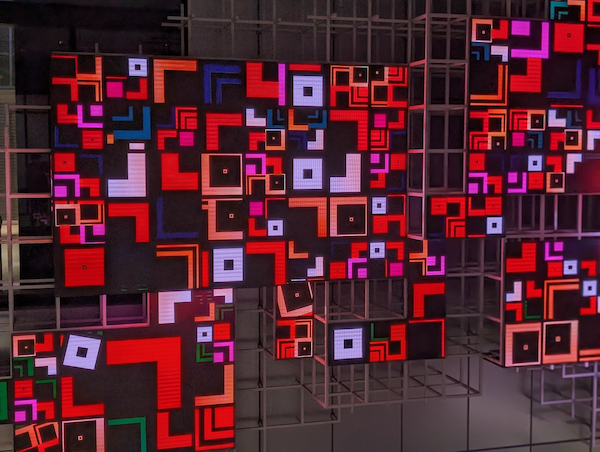

---

## 1. Color Manipulation

### Invert
Inverts all color channels.
`--invert`
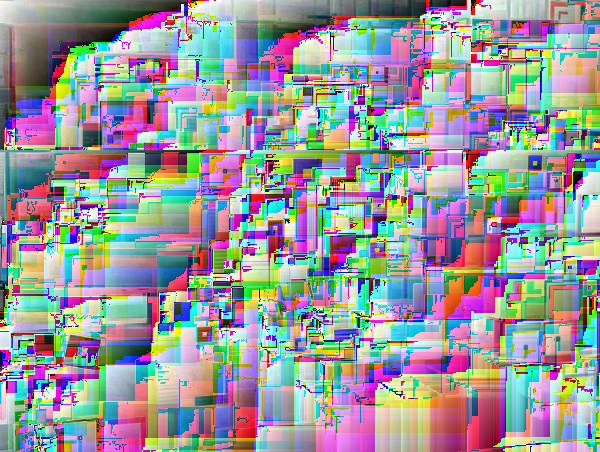

### Brighten
Increases brightness.
`--brighten 20000`


### Darken
Decreases brightness.
`--darken 40`
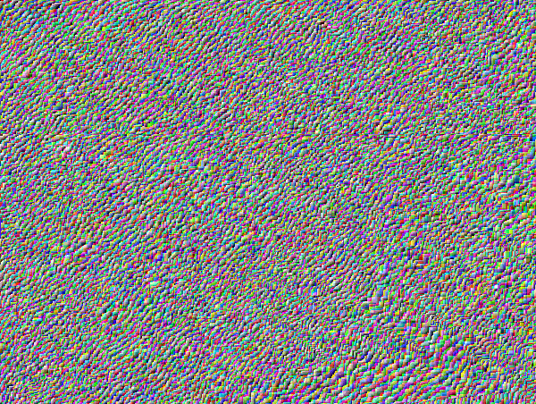

### Color Distortion
Adds random noise to each color channel.
`--color-distortion 0.1 --color-distortion-strength 50`
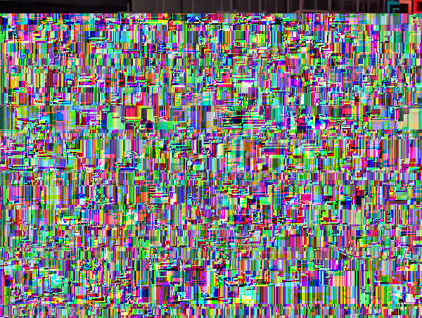

### Color Space Glitch (HSL)
Manipulates Hue, Saturation, and Lightness.
`--color-space-glitch 0.2 --hue-shift 120 --saturation-mult 1.5`
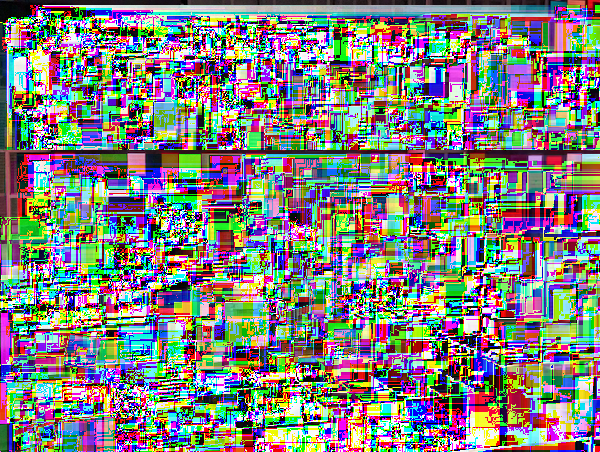

### Chromatic Aberration
Spatially shifts color channels to create fringes.
`--chromatic-aberration 0.3 --r-offset 10 --b-offset 10`
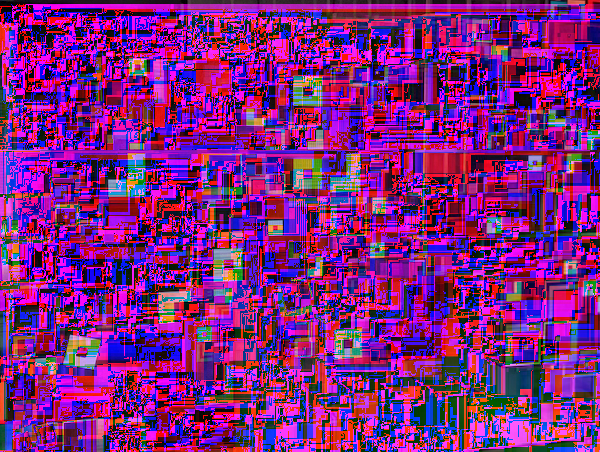

### Shift Channels
Swaps or offsets channel values directly.
`--shift-channels 10000,20000,-10000`
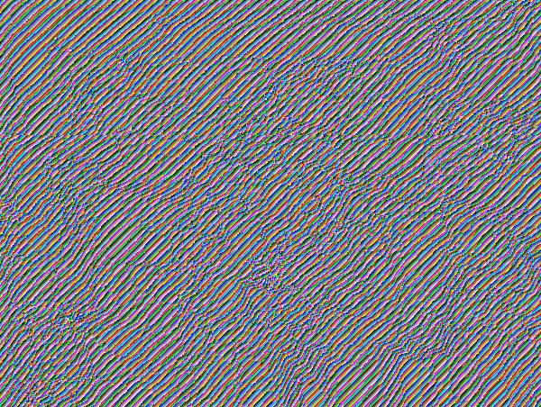

### Channel Swap
Swaps two color channels.
`-f 'channel-swap:magnitude=0.3,target=rg'`
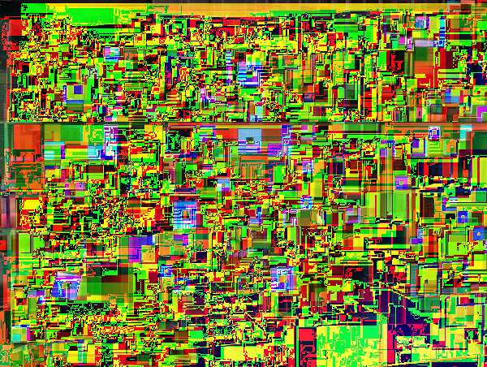

---

## 2. Structural Glitches

### Block Scramble
Shuffles image blocks in a grid.
`--block-scramble 0.1 --block-scramble-size 32`
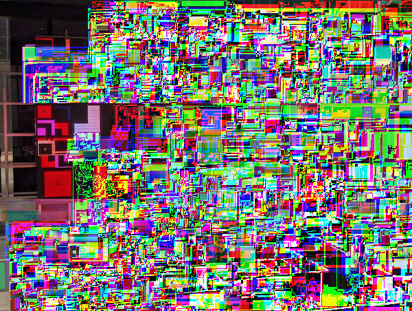

### Transpose
Randomly swaps scanlines.
`--transpose 0.1`
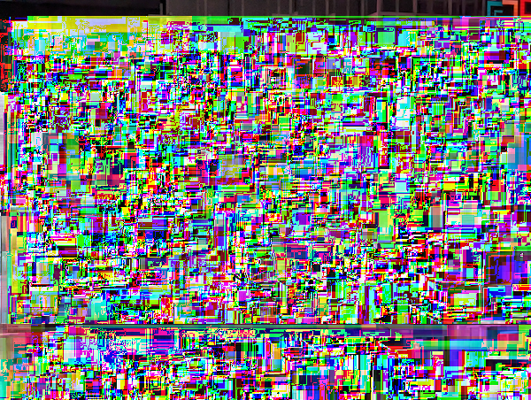

### Horizontal Shift
Offsets scanlines horizontally with wrap-around.
`--horizontal-shift 0.1`
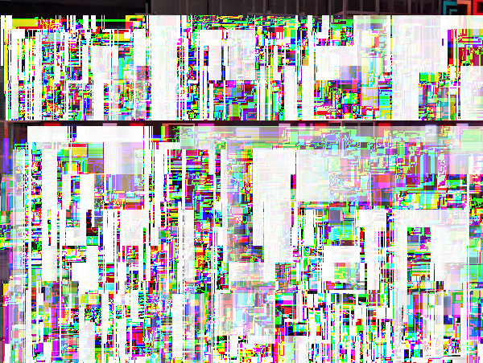

### Random Copy
Copies random scanlines to other positions.
`--random-copy 20`
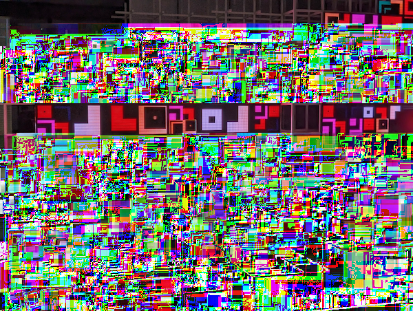

### Pixel Sort
Sorts pixels within rows by brightness or hue.
`-f 'pixel-sort:magnitude=0.3,criterion=brightness'`
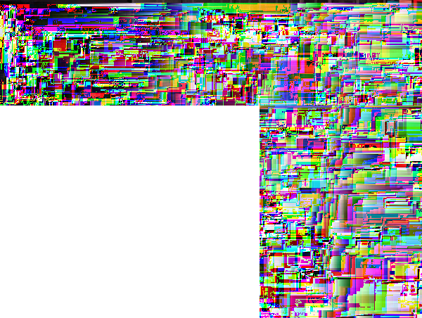

---

## 3. Bit-Level Distortion

### Replace
Replaces random bytes with noise.
`--replace 0.05`
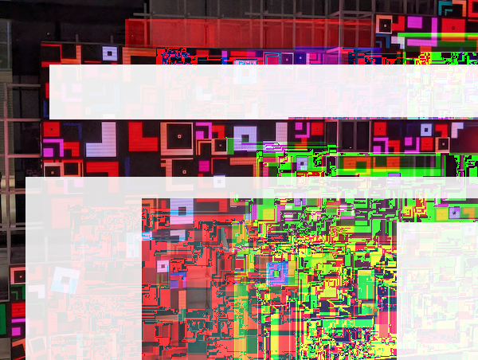

### Set Zero
Sets random bytes to zero.
`--set-zero 0.05`
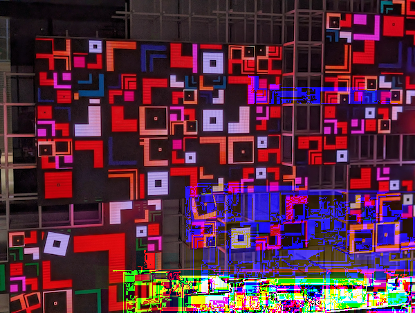

### Bitwise
Performs logical operations on raw bytes.
`--bitwise 0.1 --bitwise-op xor --bitwise-value 128`
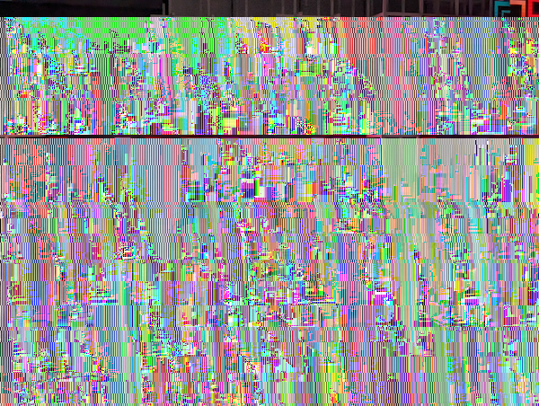

### Substitute
Overwrites a single byte in the middle scanline; the error propagates down the image.
`--substitute 100:255`
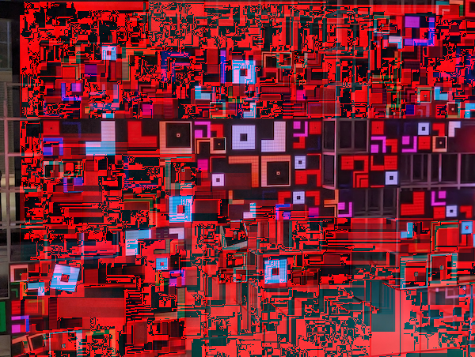

---

## 4. PNG Filter Abuse

These options force the PNG decoder to misinterpret pixels by manipulating internal filter types.

### Set Filter Type (tag only) and Regenerate (recompute)
Two different operations:

- `-f set-filter-type=paeth` overwrites the filter-type tag of every row and leaves the filtered bytes as they are, so the decoder misreads them.
- `-f regenerate=paeth` recomputes every filtered value (a new generation); the image looks the same but its bytes change. Also `regenerate=adaptive` and `regenerate=sub,up,paeth` (row `i` uses `pattern[i % len]`).

`--remove-filter`, `--sub`, `--up`, `--average` and `--paeth` are **deprecated** aliases of `regenerate=<type>` (same output; they print a warning to stderr).

### Remove Filter (deprecated, use `-f regenerate=none`)
Re-encodes every scanline with filter type `None`. The image looks unchanged, but the bytes underneath are now raw pixels, which changes what later effects do.
`--remove-filter`


### Sub
`--sub`


### Up
`--up`


### Average
`--average`
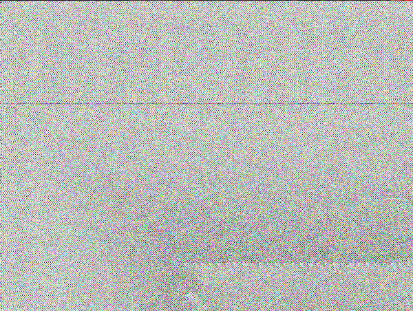

### Paeth
`--paeth`
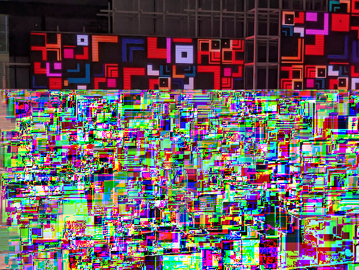

### Change Filter Type
Randomly assigns different filter types to scanlines.
`--change-filter-type 0.1`
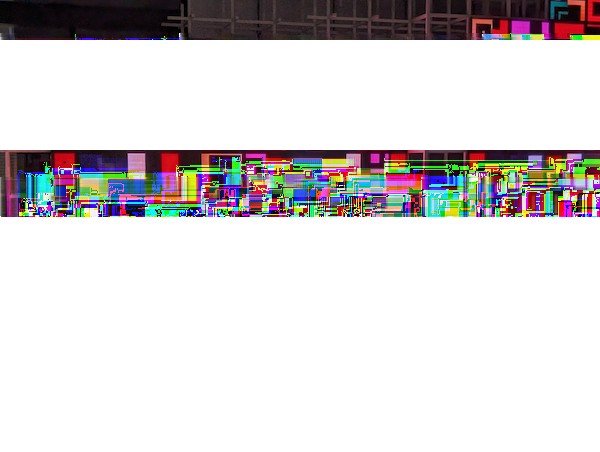

---

## 5. WebP Effects

These use `crates/webp-glitch/etc/sample00.webp` as the input.


### Macroblock Glitch
Swaps, duplicates or zeroes 16x16 VP8 macroblocks.
`--macroblock-glitch 0.15`
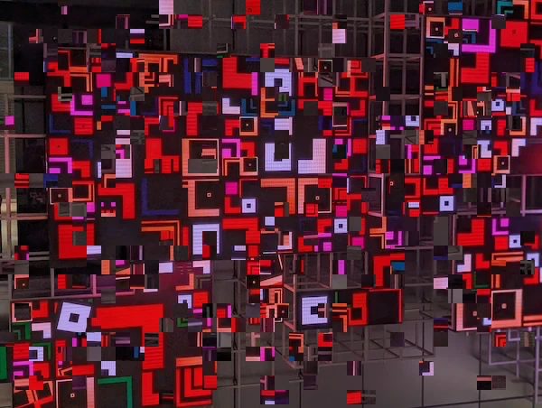

### Lossy Artifact
Re-encodes through lossy VP8 at a very low quality.
`--lossy-quality 5`
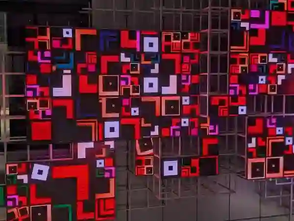

### Pixel Sort (WebP)
Effects shared with PNG work on decoded pixels for WebP, so they do not turn into noise.
`--pixel-sort 0.3`
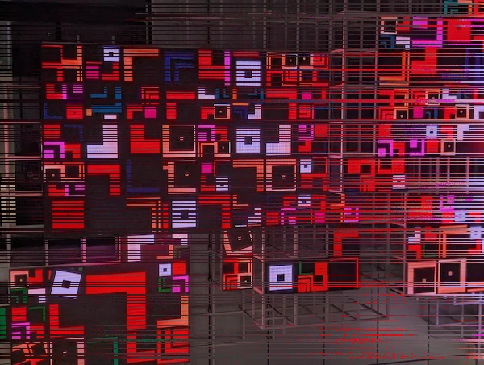

`--alpha-glitch` only affects images with an alpha channel, so it has no example here (the sample WebP has none).

---

## 6. Recipes

A recipe is a YAML list of filters, applied in order. The files are in [`gallery/recipes`](./gallery/recipes); each image is exactly the output of:

```zsh
png-glitch crates/png-glitch/etc/sample00.png --config docs/gallery/recipes/<name>.yaml --seed 42
```

(`webp-blocks` uses `crates/webp-glitch/etc/sample00.webp` instead.)

### Filtered vs. unfiltered

The same effect, without and with `remove-filter` first.

| `pixel-sort` only | [`clean-pixel-sort.yaml`](./gallery/recipes/clean-pixel-sort.yaml) |
| :---: | :---: |
|  | 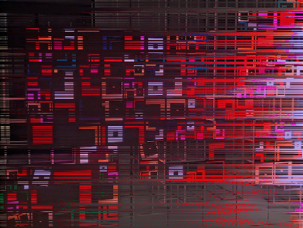 |
| **`darken` only** | **[`clean-darken.yaml`](./gallery/recipes/clean-darken.yaml)** |
|  | 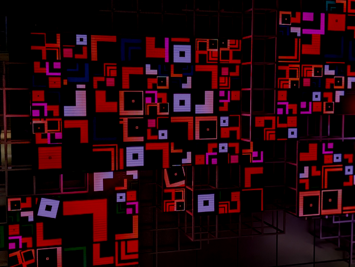 |

### VHS Tracking
[`vhs-tracking.yaml`](./gallery/recipes/vhs-tracking.yaml)
```yaml
filters:
  - type: remove-filter
  - type: horizontal-shift
    magnitude: 0.05
  - type: chromatic-aberration
    magnitude: 0.4
    r_offset: 6
    b_offset: -6
  - type: color-distortion
    magnitude: 0.15
    strength: 40
```
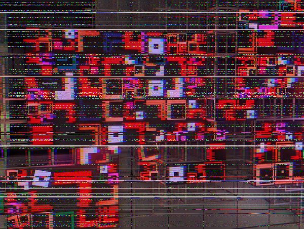

### Filter Corruption
[`filter-corruption.yaml`](./gallery/recipes/filter-corruption.yaml)
```yaml
filters:
  - type: sub-filter
  - type: change-filter-type
    magnitude: 0.2
  - type: replace
    magnitude: 0.01
```
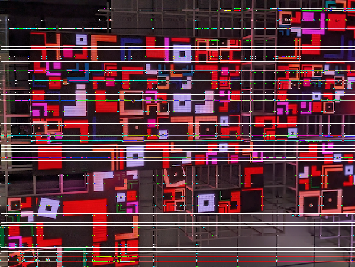

### Hue Melt
[`hue-melt.yaml`](./gallery/recipes/hue-melt.yaml)
```yaml
filters:
  - type: remove-filter
  - type: pixel-sort
    magnitude: 0.4
    criterion: hue
  - type: color-space-glitch
    magnitude: 0.3
    hue_shift: 60.0
    saturation_mult: 1.6
```
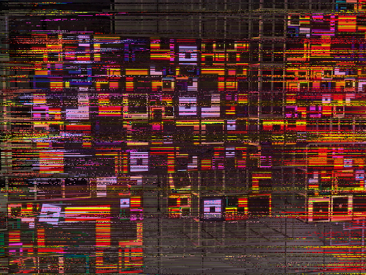

### Broken Blocks
[`broken-blocks.yaml`](./gallery/recipes/broken-blocks.yaml)
```yaml
filters:
  - type: remove-filter
  - type: block-scramble
    magnitude: 0.15
    block_size: 64
  - type: channel-swap
    magnitude: 0.3
    target: gb
  - type: bitwise
    magnitude: 0.03
    op: xor
    value: 255
```
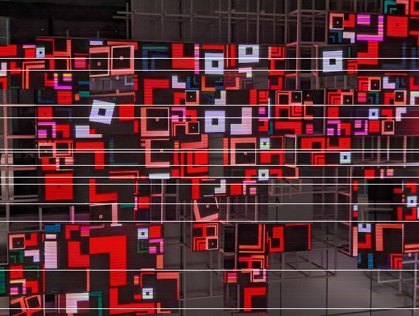

### Kitchen Sink
The pipeline from the README's configuration example.
[`kitchen-sink.yaml`](./gallery/recipes/kitchen-sink.yaml)
```yaml
filters:
  - type: remove-filter
  - type: block-scramble
    magnitude: 0.1
    block_size: 32
  - type: color-space-glitch
    magnitude: 0.2
    hue_shift: 90.0
  - type: chromatic-aberration
    magnitude: 0.1
    r_offset: 3
    b_offset: -3
  - type: invert
  - type: invert
  - type: pixel-sort
    magnitude: 0.1
    criterion: hue
  - type: horizontal-shift
    magnitude: 0.05
  - type: bitwise
    magnitude: 0.02
    op: xor
    value: 255
```
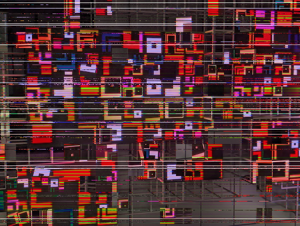

### WebP Blocks
[`webp-blocks.yaml`](./gallery/recipes/webp-blocks.yaml)
```yaml
filters:
  - type: lossy-artifact
    quality: 5.0
  - type: macroblock-glitch
    magnitude: 0.15
  - type: chromatic-aberration
    magnitude: 0.3
    r_offset: 4
    b_offset: -4
```


To add a recipe, drop a `<name>.yaml` (or `webp-<name>.yaml` for WebP) into `docs/gallery/recipes` and rerun `gen_gallery`.

---

## 7. Advanced Usage

### Batch Processing
Process all PNGs in a directory in parallel:
```zsh
png-glitch ./input_dir --batch-output ./output_dir --invert --block-scramble 0.05
```

### Reproducible Seeds
Use `--seed <N>` to get the same result every time.

### Configuration Files (YAML)
Combine multiple filters into a pipeline:
```yaml
filters:
  - type: RemoveFilter
  - type: BlockScramble
    magnitude: 0.1
  - type: ChromaticAberration
    magnitude: 0.2
    r_offset: 5
  - type: ColorSpaceGlitch
    magnitude: 0.1
    hue_shift: 180.0
```
Run with: `png-glitch input.png --config config.yaml`
